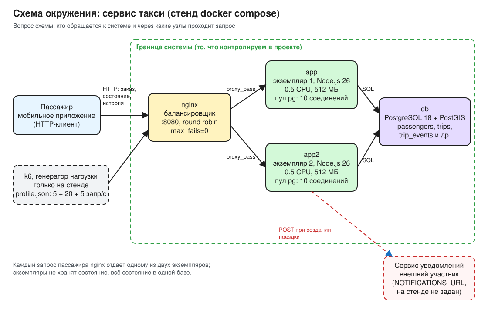
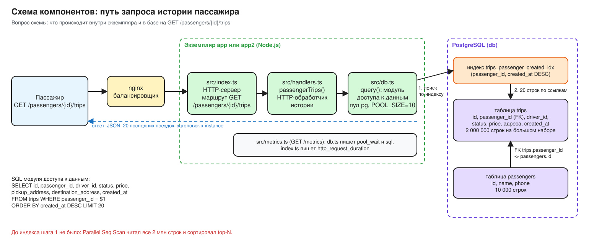
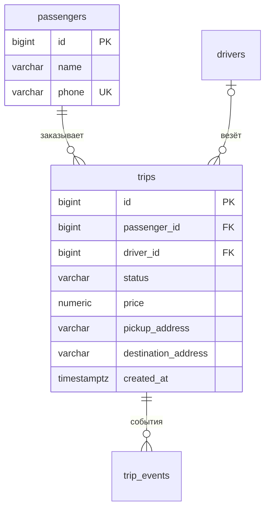

# Сервис такси под нагрузкой: проектный документ

Автор: Kichigin Sergey. Решение: [design/adr/010-history-index.md](design/adr/010-history-index.md). Замеры: [reports/baseline.md](reports/baseline.md), [reports/after-index.md](reports/after-index.md).

## Граница системы

**Назначение.** Сервис принимает заказы поездок такси, хранит их состояние и отдаёт пассажиру состояние текущей поездки и историю прошлых поездок.

**Пользователи.**

- Пассажир через мобильное приложение: создаёт поездку, во время поездки опрашивает её состояние, открывает историю.
- Водитель через своё приложение: принимает поездку, передаёт координаты. В этом проекте его операции не нагружаются и не меняются.

**Внешние участники и зависимости.**

- Сервис уведомлений: получает `POST` о созданной поездке (`NOTIFICATIONS_URL`). На стенде адрес не задан, вызов пропускается.
- PostgreSQL с PostGIS: единственное хранилище данных, общее для обоих экземпляров.
- k6: генератор нагрузки, существует только на стенде и ходит в систему так же, как пассажир, через балансировщик.

**Что входит в границу** (то, что контролируется в проекте): балансировщик nginx, два экземпляра приложения `app` и `app2`, схема и миграции базы, профиль нагрузки `load/profile.json` и отчёты замеров. Решение проекта касается только схемы базы: индекс под историю пассажира.

**Что не входит:** оплата поездки, ценообразование по спросу, подбор водителя и маршрутизация, аналитика по поездкам, приложение пассажира и сам сервис уведомлений. Это уместные для такси задачи, но в этом проекте они не проектируются и не измеряются.

## Требования

Три потока считаются от суточных чисел города. В сутках 86 400 секунд.

**Создание поездки.**

| Шаг | Исходное число | Действие | Результат |
| --- | --- | --- | --- |
| средняя частота | 200 000 поездок в сутки | 200 000 / 86 400 с | 2.31 запроса/с |
| пиковая частота | 2.31 запроса/с, коэффициент пика ×4 | 2.31 × 4 | **9.26 запроса/с** |

**Чтение состояния поездки.**

| Шаг | Исходное число | Действие | Результат |
| --- | --- | --- | --- |
| чтений на поездку | поездка 15 мин = 900 с, один запрос каждые 5 с | 900 с / 5 с | 180 чтений на поездку |
| чтений в сутки | 200 000 поездок в сутки | 200 000 × 180 | 36 000 000 чтений в сутки |
| средняя частота | 36 000 000 чтений в сутки | 36 000 000 / 86 400 с | 416.67 запроса/с |
| пиковая частота | 416.67 запроса/с, коэффициент пика ×4 | 416.67 × 4 | **1 666.67 запроса/с** |

**Просмотр истории.**

| Шаг | Исходное число | Действие | Результат |
| --- | --- | --- | --- |
| средняя частота | 60 000 открытий в сутки | 60 000 / 86 400 с | 0.69 запроса/с |
| пиковая частота | 0.69 запроса/с, коэффициент пика ×2 | 0.69 × 2 | **1.39 запроса/с** |

**Объём поездок за год** при среднем потоке: 2.31 поездки/с × 31 536 000 с в году = 200 000 поездок в сутки × 365 сут = **73 000 000 поездок в год**. Строка `trips` на стенде занимает в среднем 222 байта (443 621 376 байт таблицы / 2 000 000 строк), значит за год таблица вырастет примерно на 16 ГБ без индексов. Это оценка по учебным данным с короткими адресами.

**Цель истории:** p95 времени ответа `GET /passengers/{id}/trips` меньше **50 мс** на 2 000 000 поездок. Допустимая доля ошибок по всем запросам **0.1 %** (0.001). Оба замера сравниваются с этими числами.

**Частоты локального стенда** (`load/profile.json`, раздел `stand`): 5 созданий, 20 чтений состояния и 5 чтений истории в секунду, 30 с измерения после 10 с прогрева.

| Поток | Пик города | Стенд | Отношение |
| --- | --- | --- | --- |
| создание поездки | 9.26 запроса/с | 5 запросов/с | 0.54 |
| чтение состояния | 1 666.67 запроса/с | 20 запросов/с | 0.012 |
| просмотр истории | 1.39 запроса/с | 5 запросов/с | 3.6 |

Стенд не воспроизводит город. Генератор, балансировщик, два экземпляра и база работают на одной машине и делят 4 ядра ВМ Docker, у каждого экземпляра 0.5 CPU, а сеть между контейнерами быстрее сети между серверами. Поэтому локальный опыт проверяет причинную связь «как устроено чтение истории → сколько оно стоит» на ограниченной машине: история нагружена сильнее городского пика, чтобы её цена была видна, а остальные два потока создают фон из записи и коротких чтений. Предел системы в запросах в секунду по этим числам не определяется.

## Операции

| Операция | Сценарий пассажира | HTTP | Что делает в базе | Пиковая частота города | Стенд |
| --- | --- | --- | --- | --- | --- |
| Создание поездки | заказывает такси | `POST /trips` с `Idempotency-Key` | транзакция: `INSERT` в `trips`, `trip_events`, `idempotency_keys` | 9.26 запроса/с | 5 запросов/с |
| Чтение состояния | ждёт машину и едет, приложение опрашивает раз в 5 с | `GET /trips/{id}` | `SELECT` по первичному ключу `trips.id` | 1 666.67 запроса/с | 20 запросов/с |
| Просмотр истории | открывает список прошлых поездок | `GET /passengers/{id}/trips` | `SELECT` 20 последних поездок пассажира | 1.39 запроса/с | 5 запросов/с |

## Окружение

Схема отвечает на вопрос, кто обращается к системе и через какие узлы проходит запрос. Запрос пассажира приходит на балансировщик nginx, который по очереди (round robin) отдаёт его одному из двух экземпляров `app` или `app2`. Экземпляры не хранят состояние и работают с одной базой PostgreSQL, каждый через свой пул из 10 соединений. Сервис уведомлений — внешний участник за границей системы.

Исходник со встроенной сценой Excalidraw: [design/architecture/environment.excalidraw.svg](design/architecture/environment.excalidraw.svg), открывается в excalidraw.com через Open.

## Компоненты

Схема отвечает на другой вопрос: что происходит внутри экземпляра и в базе, когда пассажир открывает историю.

Исходник: [design/architecture/components.excalidraw.svg](design/architecture/components.excalidraw.svg).

**Критический путь истории** от HTTP-запроса до ответа:

1. Приложение пассажира отправляет `GET /passengers/42/trips` на балансировщик nginx (`:8080`).
2. nginx передаёт запрос одному из экземпляров (`proxy_pass` на `app:8080` или `app2:8080`).
3. HTTP-сервер `src/index.ts` сопоставляет путь с маршрутом `/passengers/(\d+)/trips` и вызывает обработчик.
4. HTTP-обработчик истории `passengerTrips()` в `src/handlers.ts` формирует запрос с параметром `passenger_id = 42`.
5. Модуль доступа к данным `query()` в `src/db.ts` берёт соединение из пула pg (до 10 на экземпляр) и выполняет SQL; время ожидания соединения и время самого SQL пишутся в `src/metrics.ts` раздельно (`pool_wait`, `sql`).
6. PostgreSQL выполняет `SELECT … FROM trips WHERE passenger_id = $1 ORDER BY created_at DESC LIMIT 20`. После решения: спуск по индексу `trips_passenger_created_idx` к пассажиру 42, чтение первых 20 записей индекса, которые уже упорядочены по `created_at DESC`, и 20 строк таблицы `trips` по ссылкам. До решения на этом шаге был полный просмотр таблицы и сортировка.
7. Обработчик превращает строки в JSON, сервер отвечает `200` с заголовком `x-instance`, nginx возвращает ответ пассажиру.

На стенде шаг 6 занимал почти всё время ответа: до индекса p95 SQL 122–230 мс при нулевом ожидании пула, после индекса 4–6 мс.

## Модель данных

- `passengers` — пассажир: `id`, `name`, `phone` (уникальный).
- `trips` — поездка. Поле `trips.passenger_id` — внешний ключ на `passengers.id`: у одного пассажира много поездок (один ко многим), у поездки ровно один пассажир. `driver_id` заполняется, когда водитель принял заказ. `status` проходит состояния `searching → accepted → in_progress → completed` или `cancelled`. `created_at` — момент заказа, выставляется базой при вставке и потом не меняется.
- Рядом лежат `drivers`, `trip_events` (журнал событий поездки), `idempotency_keys` (ключи повторов создания), `driver_locations`, `tariffs`; история их не читает.

**Поля запроса истории.** История — это «мои поездки» одного пассажира, поэтому запрос фильтрует по `passenger_id`: чужие поездки в ответ попадать не должны. Пассажиру нужны сначала последние поездки, а их число растёт годами, поэтому запрос сортирует по `created_at DESC` и отдаёт первые 20 (`LIMIT 20`). `created_at` подходит для сортировки, потому что не меняется после вставки. Индекс `trips_passenger_created_idx (passenger_id, created_at DESC)` повторяет эти два поля в том же порядке: сначала фильтр, потом сортировка.

На большом наборе 10 000 пассажиров и 2 000 000 поездок, по 200 поездок на пассажира.

## Итог

| Требование | Базовый результат | Решение | Повторный результат |
| --- | --- | --- | --- |
| p95 истории < 50 мс на 2 000 000 поездок, ошибок ≤ 0.1 % | p95 1103.5 мс, ошибок 0.00 %, `dropped_iterations` 0; план `Parallel Seq Scan`, 2 000 000 строк и 54 223 страницы на запрос ([reports/baseline.md](reports/baseline.md)) | составной индекс `trips_passenger_created_idx (passenger_id, created_at DESC)` миграцией `db/migrations/003-history-index.sql` ([ADR 010](design/adr/010-history-index.md)) | p95 7.9 мс, ошибок 0.00 %, `dropped_iterations` 0; план `Index Scan`, 20 строк и 23 страницы на запрос ([reports/after-index.md](reports/after-index.md)) |

Требование выполнено: p95 истории упал в 140 раз и ниже цели с запасом. Цена решения — 60–78 МБ индекса на 2 млн поездок и дополнительное обновление B-дерева при каждой вставке (заливка 2 млн строк +6 %).

**Условия, при которых вывод сохраняется.**

- объём данных: 2 000 000 поездок, 10 000 пассажиров по 200 поездок, данные из `make seed-large`, одинаковые в обоих прогонах;
- профиль нагрузки: `load/profile.json`, сценарий `load/mixed.ts`, 5 созданий + 20 чтений состояния + 5 чтений истории в секунду, прогрев 10 с, измерение 30 с, по одному прогону до и после;
- стенд: одна машина (i7-11700K, ВМ Docker 4 ядра и 7.76 ГиБ), по 0.5 CPU и 512 МБ на экземпляр, пул 10 соединений, PostgreSQL 18 с настройками по умолчанию, генератор на той же машине.

Вывод переносится как зависимость: время истории с индексом определяется размером ответа, а не размером таблицы. Абсолютные миллисекунды на 73 млн поездок в год, на отдельных серверах и с другой длиной истории пассажира не переносятся и требуют своего замера.

**Следующий ожидаемый предел.** После индекса история больше не упирается в базу: SQL p95 4–6 мс, ожидание пула p99 1 мс. Самый частый поток — чтение состояния: в пике города 1 666.67 запроса/с, а на стенде подавалось только 20, в 83 раза меньше. Каждое чтение проходит через экземпляр с лимитом 0.5 CPU и пул из 10 соединений, поэтому следующим пределом ожидается процессор экземпляров приложения или ожидание соединения в пуле на потоке чтения состояния, а не диск базы: чтение по первичному ключу дешёвое.

**Следующий опыт.**

- вопрос: при какой частоте чтения состояния стенд перестаёт держать p95 чтения состояния ниже 50 мс и что упирается первым, CPU экземпляров или пул соединений;
- изменяемый фактор: только `stand.readRate` в `load/profile.json`, ступенями 20 → 100 → 200 → 400 → 800 запросов/с; данные (`make seed-large`), индекс, частоты создания и истории, лимиты контейнеров не меняются;
- что смотреть: `http_req_duration{scenario:reads}` (добавить порог по этой метрике в `load/mixed.ts`, чтобы k6 выписал её в отчёт), `pool_wait` и `sql` из `GET /metrics` обоих экземпляров, загрузку CPU в `docker stats`;
- критерий прохождения ступени: p95 чтения состояния < 50 мс, `http_req_failed` ≤ 0.1 %, `dropped_iterations` = 0; предел — первая ступень, где критерий нарушен, а причина определяется по тому, что выросло первым: `pool_wait` (пул) или CPU экземпляров при низком `pool_wait`.
